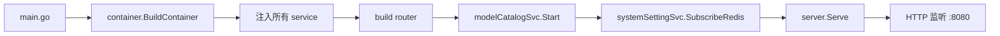
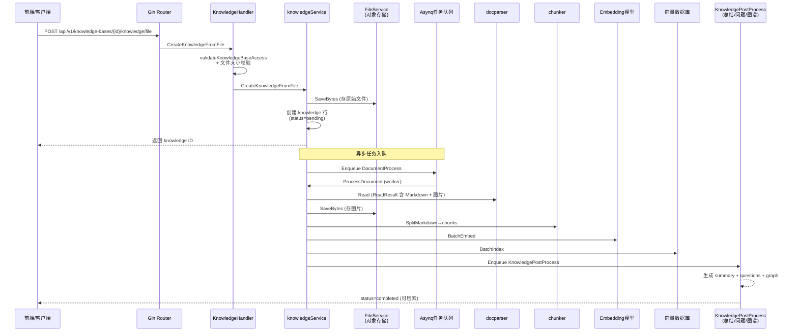
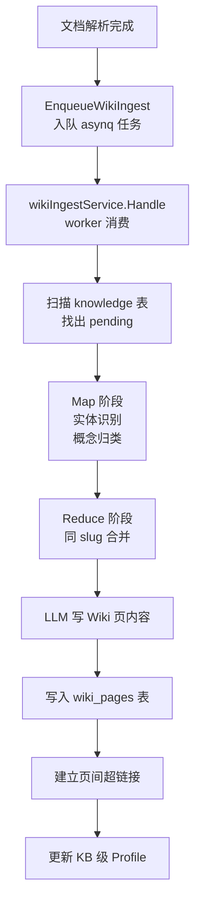
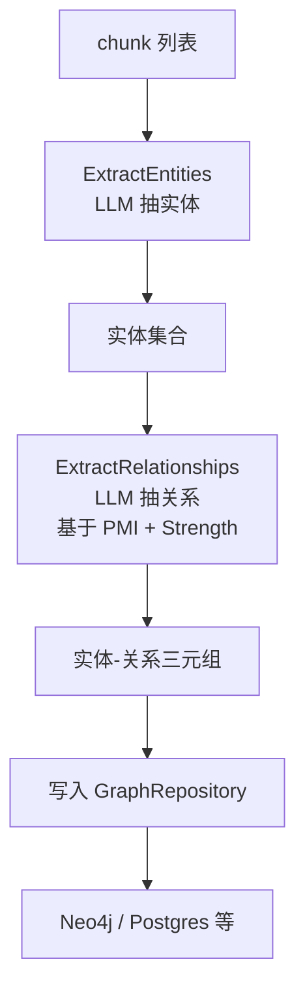
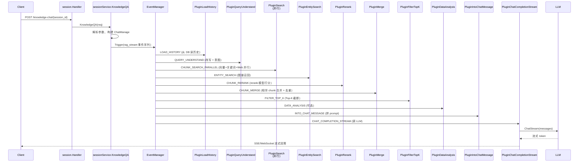

# WeKnora 架构梳理与 MCP 封装要点

> 本文档面向「把现有能力封装为 MCP」的二次开发场景，从全局鸟瞰 → 业务链路 → 关键代码位置三层递进，重点回答 **"一个请求进来，背后到底跑了哪些逻辑"**。
>
> 阅读建议：先看「一、全局鸟瞰」建立整体地图，再按需跳到「二~五」对应业务，最后看「六、关键代码速查」找到每个能力对应的入口文件和函数。
>
> 版本基线：`cmd/server/main.go` 为单进程入口；`internal/application/service` 为业务核心；`internal/handler` 为 HTTP 入口；`internal/mcpserver` 已经是 MCP 适配层（[tools_ask.go](internal/mcpserver/tools_ask.go)、[tools_retrieve.go](internal/mcpserver/tools_retrieve.go) 等）。

---

## 一、全局鸟瞰

### 1.1 一句话定位

WeKnora 是 **腾讯开源的 LLM 驱动企业知识管理框架**，核心 = **RAG 检索 + Agent 多步推理 + Wiki 知识整理**，三大能力共用同一套知识库。

### 1.2 技术栈速览

| 维度 | 选型 | 说明 |
|------|------|------|
| 后端语言 | Go 1.x | 单进程多 goroutine，模块化清晰 |
| Web 框架 | Gin | 路由集中在 `internal/router/` |
| 依赖注入 | `internal/container` | 手写 DI 容器，启动时构造所有 service |
| 异步任务 | asynq（基于 Redis） | 文档解析、wiki 入库、总结生成等长耗时操作 |
| 关系数据库 | Postgres / SQLite | 通过 gorm，多租户数据 |
| 向量数据库 | 可插拔 | Milvus / Elasticsearch / OpenSearch 等（`internal/application/repository/retriever`） |
| 大模型 | 29+ 厂商 | 通过统一 `chat.Chat` 接口适配 |
| 嵌入式模型 | 可插拔 | OpenAI / HuggingFace / BGE 等 |
| 追踪 | Langfuse | `internal/tracing/langfuse` |
| MCP | 自带 MCP Server | `internal/mcpserver`，直接对外 |

### 1.3 顶层模块地图

```
WeKnora/
├── cmd/server/                 # 程序入口（main.go → container → router）
├── internal/
│   ├── container/              # 依赖注入容器
│   ├── router/                 # Gin 路由注册
│   ├── handler/                # HTTP handler（请求解析/响应）
│   ├── application/
│   │   ├── service/            # 业务编排（核心）
│   │   │   ├── chat_pipeline/  # 问答流水线（事件驱动插件链）
│   │   │   ├── knowledge*.go   # 文档解析、索引
│   │   │   ├── wiki_*.go       # Wiki 入库
│   │   │   ├── graph.go        # 知识图谱构建
│   │   │   ├── extract.go      # LLM 抽取
│   │   │   └── retriever/      # 检索引擎（向量/关键词混合）
│   │   └── repository/         # 数据访问层
│   ├── infrastructure/         # 基础设施（docparser、chunker、vector store）
│   ├── models/                 # chat/embedding/rerank/asr 模型适配
│   ├── event/                  # 事件总线
│   ├── tracing/langfuse/       # 可观测性
│   ├── mcpserver/              # 已有的 MCP Server（MCP 封装的工作面）
│   ├── mcp/                    # MCP endpoint（外部 MCP 客户端接入）
│   └── mcpscope/               # MCP 作用域/权限
├── docreader/                  # 文档解析 Python 服务（grpc/http）
└── frontend/                  # Web 前端
```

### 1.4 架构分层

```
┌─────────────────────────────────────────────────┐
│  HTTP层 (Gin)                                    │  internal/handler
│   ↓                                              │
│  Service层（业务编排）                            │  internal/application/service
│   ├─ chat_pipeline/  (问答流水线的插件链)        │
│   ├─ knowledge*.go    (文档摄入)                │
│   ├─ wiki_*.go        (Wiki 生成)               │
│   └─ graph.go         (图谱抽取)                │
│   ↓                                              │
│  Infrastructure层（基础设施能力）                 │  internal/infrastructure
│   ├─ docparser/   (文件→Markdown+图片)           │
│   ├─ chunker/     (切片)                      │
│   └─ storage/                    │
│   ↓                                              │
│  Repository层（数据持久化）                       │  internal/application/repository
│   └─ retriever/  (向量/关键词索引 + 混合检索)     │
└─────────────────────────────────────────────────┘
```

### 1.5 启动流程一览



入口文件：[cmd/server/main.go](cmd/server/main.go) — DI 容器构建 + Gin 路由注册 + HTTP 服务监听。

---

## 二、文档上传与解析链路

### 2.1 业务场景
> 故事：用户上传一个 PDF / 图片 / URL，系统把文件存到对象存储，解析成 Markdown + 图片，按语义切片，调用 Embedding 模型向量化，写入向量库，最终可被 RAG 检索到。

### 2.2 完整调用链



### 2.3 关键代码路径

| 步骤 | 文件 | 函数 | 备注 |
|------|------|------|------|
| HTTP 入口 | [internal/handler/knowledge.go](internal/handler/knowledge.go) | `CreateKnowledgeFromFile` | 解析 multipart、校验大小、调 service |
| HTTP 入口（URL） | [internal/handler/knowledge.go](internal/handler/knowledge.go) | `CreateKnowledgeFromURL` | 校验 SSRF、下载、调 service |
| HTTP 入口（手动文本） | [internal/handler/knowledge.go](internal/handler/knowledge.go) | `CreateManualKnowledge` | 直接传入 Markdown 文本 |
| 创建 knowledge 记录 | [internal/application/service/knowledge.go](internal/application/service/knowledge.go) | `CreateKnowledgeFromFile/URL/Passage` | 写 knowledge 行 + 入队 asynq |
| 异步 worker 处理 | [internal/application/service/knowledge_process.go](internal/application/service/knowledge_process.go) | `ProcessDocument` | asynq 消费端，处理整条解析链路 |
| 文档解析器 | [internal/infrastructure/docparser/](internal/infrastructure/docparser/) | `engine_registry.NewReader` | 注册多个解析引擎（anydoc/MinerU/PaddleOCR-VL 等） |
| 切片器 | [internal/infrastructure/chunker/](internal/infrastructure/chunker/) | `SplitMarkdown` | 按语义切 chunk，支持 parent-child |
| 向量索引 | [internal/application/service/retriever/](internal/application/service/retriever/) | `CompositeRetrieveEngine.BatchIndex` | 写入向量数据库 |
| 后处理（总结/问题/图谱） | [internal/application/service/knowledge_post_process.go](internal/application/service/knowledge_post_process.go) | `KnowledgePostProcess` | LLM 生成 summary + 自动问题 + 图谱 |
| 文件存储 | [internal/application/service/file/](internal/application/service/file/) | `FileService.SaveBytes` | 支持本地/MinIO/S3 |

### 2.4 解析引擎清单

`docparser` 是可插拔的解析引擎注册中心（[internal/infrastructure/docparser/doc.go](internal/infrastructure/docparser/doc.go)）：

- **进程内解析**：`SimpleFormatReader`、`AnydocReader`
- **gRPC / HTTP 远程解析**：`GRPCDocumentReader`、`HTTPDocumentReader`（连外部 docreader 服务）
- **远程云端解析**：`MinerU`、`PaddleOCR-VL`、`WeKnora Cloud`

所有解析器返回统一的 `types.ReadResult{Markdown, Images, ...}`，下游处理逻辑与引擎无关。

### 2.5 切片策略

切片器支持多种策略（`internal/infrastructure/chunker`）：
- 按 Markdown 标题层级
- 按字符数（ChunkSize + ChunkOverlap）
- 按 token 限制
- Parent-Child 双层切片（大 chunk 提升上下文，小 chunk 提升召回）

### 2.6 后处理任务

文档解析完成、向量已建索引后，触发 `KnowledgePostProcess`（`knowledge_post_process.go`），并行执行：

1. **Summary 生成**（`ProcessSummaryGeneration`）— 用 chat 模型生成文档摘要 + Profile
2. **问题生成**（`ProcessQuestionGeneration`）— 为每个 chunk 生成 3 个模拟问题，提升召回
3. **图谱抽取**（`ProcessGraphExtraction`）— 实体识别 + 关系抽取
4. **Wiki 触发**（`EnqueueWikiIngest`）— 如果 KB 配置了 Wiki，则触发 Wiki 生成

每个任务独立失败 → 记入 `summary_status`/`question_status`/`graph_status`，互不影响主解析流程。

---

## 三、Wiki 与 Graph 知识图谱

### 3.1 Wiki 子系统

Wiki 子系统把知识库自动组织成 Wiki 页：实体页、概念页、总结页、索引页。

#### 3.1.1 Wiki 生成流程



#### 3.1.2 Wiki 关键代码

| 步骤 | 文件 | 函数 |
|------|------|------|
| 入队任务 | [internal/application/service/wiki_ingest.go](internal/application/service/wiki_ingest.go) | `EnqueueWikiIngest` |
| Worker 入口 | [internal/application/service/wiki_ingest.go](internal/application/service/wiki_ingest.go) | `wikiIngestService.Handle` |
| Wiki 页面 CRUD | [internal/application/service/wiki_page.go](internal/application/service/wiki_page.go) | `CreatePage/UpdatePage/ListPages/GetGraph` |
| Wiki 反向链接 | [internal/application/service/wiki_linkify.go](internal/application/service/wiki_linkify.go) | `Linkify` |
| Wiki Lint | [internal/application/service/wiki_lint.go](internal/application/service/wiki_lint.go) | `Lint` |

#### 3.1.3 Wiki 页面类型

- **实体页**（entity）— 由实体识别触发
- **概念页**（concept）— 由概念归类触发
- **总结页**（summary）— 每个文档一篇
- **索引页**（index）— KB 级入口页
- **文件夹页**（folder）— KB 下文件夹聚合

#### 3.1.4 并发与锁

Wiki 入库用 Redis Lua 脚本做并发控制（`wiki_ingest.go` 中 `wikiIdentityClaimScript`），避免同 slug 被并发 reducer 写穿。

### 3.2 Graph（知识图谱）子系统

Graph 子系统从每个 chunk 抽取实体 + 关系，构建图谱，存入图数据库（如 Neo4j，可选）。

#### 3.2.1 图谱构建流程



#### 3.2.2 图谱关键代码

| 步骤 | 文件 | 函数 |
|------|------|------|
| 构建器入口 | [internal/application/service/graph.go](internal/application/service/graph.go) | `BuildGraph`、`graphBuilder.extractEntities` |
| 关系抽取 | [internal/application/service/graph.go](internal/application/service/graph.go) | `graphBuilder.extractRelationships` |
| 图谱存储 | [internal/application/repository/retriever/neo4j/](internal/application/repository/retriever/neo4j/) | Neo4j 实现 |
| 图谱查询 | [internal/application/service/graph.go](internal/application/service/graph.go) | `GraphRetrieval`（query 走图谱） |
| 接口抽象 | [internal/types/interfaces/retriever_graph.go](internal/types/interfaces/retriever_graph.go) | `RetrieveGraphRepository` |

#### 3.2.3 图谱在 RAG 中的角色

Chat pipeline 中有专门的 `ENTITY_SEARCH` 阶段：从 query 里识别实体 → 在图谱里查邻居 → 把相关 chunk 注入上下文。这是 `search_entity.go` 的职责。

---

## 四、问答与 RAG 检索流程

### 4.1 业务场景
> 故事：用户提了一个问题，系统先理解问题、决定要不要查知识库，从向量库 + 关键词 + 图谱召回候选 chunk，rerank 重排，合并去重，注入 LLM prompt，最后 LLM 输出答案。

### 4.2 Chat Pipeline 是一张事件驱动的插件链

`internal/application/service/chat_pipeline/chat_pipeline.go` 定义了 `Plugin` 接口和 `EventManager`：每个能力（如查询理解、检索、重排、LLM 调用）都是一个插件，按事件名订阅。

事件类型（`internal/types/chat_manage.go`）：
```
LOAD_HISTORY          // 加载对话历史
MEMORY_RECALL         // 长期记忆召回
QUERY_UNDERSTAND      // 查询理解（改写+意图识别）
CHUNK_SEARCH          // 串行检索
CHUNK_SEARCH_PARALLEL // 并行检索
ENTITY_SEARCH         // 图谱实体检索
CHUNK_RERANK          // 重排
WEB_FETCH             // Web 搜索
CHUNK_MERGE           // 合并去重
DATA_ANALYSIS         // 数据分析（CSV/Excel SQL）
INTO_CHAT_MESSAGE     // 组装 prompt
CHAT_COMPLETION       // LLM 调用（非流式）
CHAT_COMPLETION_STREAM // LLM 调用（流式）
FILTER_TOP_K          // Top-K 过滤
```

预定义流水线（`Pipeline` map）：
- `chat`：仅 `CHAT_COMPLETION`
- `chat_stream`：仅 `CHAT_COMPLETION_STREAM`
- `rag`：`CHUNK_SEARCH → CHUNK_RERANK → CHUNK_MERGE → INTO_CHAT_MESSAGE → CHAT_COMPLETION`
- `rag_stream`：完整 9 阶段，含 query understand、并行检索、rerank、merge、filter、data analysis、into chat、stream completion

`PipelineBuilder` 支持 `AddIf` 动态拼装。

### 4.3 完整 RAG 流水线（rag_stream）



### 4.4 关键代码路径

| 步骤 | 文件 | 函数 |
|------|------|------|
| HTTP 入口 | [internal/router/routes_chat.go](internal/router/routes_chat.go) | `RegisterChatRoutes` (`POST /knowledge-chat/:session_id`) |
| Handler | [internal/application/service/session/handler.go](internal/application/service/session/) | `KnowledgeQA` |
| 业务入口 | [internal/application/service/session_knowledge_qa.go](internal/application/service/session_knowledge_qa.go) | `sessionService.KnowledgeQA` |
| 流水线组装 | [internal/application/service/chat_pipeline/chat_pipeline.go](internal/application/service/chat_pipeline/chat_pipeline.go) | `EventManager` / `Pipeline` |
| 查询理解 | [internal/application/service/chat_pipeline/query_understand.go](internal/application/service/chat_pipeline/query_understand.go) | `PluginQueryUnderstand` |
| 查询扩展 | [internal/application/service/chat_pipeline/query_expansion.go](internal/application/service/chat_pipeline/query_expansion.go) | `PluginQueryExpansion` |
| 检索（KB） | [internal/application/service/chat_pipeline/search.go](internal/application/service/chat_pipeline/search.go) | `PluginSearch` |
| 检索（图谱） | [internal/application/service/chat_pipeline/search_entity.go](internal/application/service/chat_pipeline/search_entity.go) | `PluginEntitySearch` |
| 并行检索 | [internal/application/service/chat_pipeline/search_parallel.go](internal/application/service/chat_pipeline/search_parallel.go) | `PluginSearchParallel` |
| 重排 | [internal/application/service/chat_pipeline/rerank.go](internal/application/service/chat_pipeline/rerank.go) | `PluginRerank` |
| 合并去重 | [internal/application/service/chat_pipeline/merge.go](internal/application/service/chat_pipeline/merge.go) | `PluginMerge` |
| Top-K 过滤 | [internal/application/service/chat_pipeline/filter_top_k.go](internal/application/service/chat_pipeline/filter_top_k.go) | `PluginFilterTopK` |
| 数据分析 | [internal/application/service/chat_pipeline/data_analysis.go](internal/application/service/chat_pipeline/data_analysis.go) | `PluginDataAnalysis` |
| 拼 prompt | [internal/application/service/chat_pipeline/into_chat_message.go](internal/application/service/chat_pipeline/into_chat_message.go) | `PluginIntoChatMessage` |
| LLM 流式 | [internal/application/service/chat_pipeline/chat_completion_stream.go](internal/application/service/chat_pipeline/chat_completion_stream.go) | `PluginChatCompletionStream` |
| 引用拼接 | [internal/application/service/chat_pipeline/references.go](internal/application/service/chat_pipeline/references.go) | `PluginReferences` |
| 记忆召回 | [internal/application/service/chat_pipeline/memory_recall.go](internal/application/service/chat_pipeline/memory_recall.go) | `PluginMemoryRecall` |
| Wiki 加权 | [internal/application/service/chat_pipeline/wiki_boost.go](internal/application/service/chat_pipeline/wiki_boost.go) | `PluginWikiBoost` |
| Web 抓取 | [internal/application/service/chat_pipeline/web_fetch.go](internal/application/service/chat_pipeline/web_fetch.go) | `PluginWebFetch` |

### 4.5 检索引擎（`internal/application/service/retriever/`）

`CompositeRetrieveEngine` 用复合模式管理多个检索引擎：

- **向量检索**（`RetrieverTypeVector`）— 调用 embedding 模型 → 向量库查近邻
- **关键词检索**（`RetrieverTypeKeywords`）— 全文索引（BM25）
- **混合检索**（`RetrieverTypeHybrid`）— 上述两者加权融合
- **图谱检索**（`RetrieverTypeGraph`）— 通过 `RetrieveGraphRepository` 接口

工厂在 `factory.go`，注册中心在 `registry.go`，归一化在 `normalizer.go`。

---

## 五、快速回答与智能推理

### 5.1 快速回答（FAQ 直答）

FAQ 是预置的问答对（QA Pair），命中相似问题时直接返回答案，跳过 LLM 调用。

代码位置：`internal/application/service/faq*.go`、chat pipeline 的 `merge_faq.go`。

流程：
1. 用户 query 进 pipeline
2. FAQ 模块先用 embedding 算 query 与 FAQ 的相似度
3. 相似度 > `FAQDirectAnswerThreshold` → 直接返回 FAQ 答案（不调 LLM）
4. 否则继续走正常 RAG 流程

可以通过 `FAQScoreBoost` 给命中 FAQ 的 chunk 在 rerank 阶段加权。

### 5.2 智能推理（Agent 多步）

Agent 子系统（`internal/agent/`）独立于 RAG，支持多步推理 + 工具调用：

- 工具注册在 `internal/agent/tools/`
- Agent Engine 在 `internal/agent/`
- 多步循环：思考 → 选工具 → 执行 → 观察 → 再思考
- 支持 Sandbox（Docker/E2B/Cube 三种）
- 支持 MCP 外部工具（OAuth）
- 支持 BrowserSkill（控制用户 Chrome/Edge）
- 支持 Skill（从 ClawHub / SkillHub / Git / ZIP 安装）

入口在 `internal/agent/agent_service.go`，agent chat 路由在 `POST /agent-chat/:session_id`。

### 5.3 长期记忆（Memory）

跨会话长期记忆：在 `MEMORY_RECALL` 阶段召回与当前 query 相关的历史记忆，注入系统 prompt。

代码位置：
- [internal/application/service/chat_pipeline/memory_recall.go](internal/application/service/chat_pipeline/memory_recall.go)
- [internal/application/service/chat_pipeline/memory_affinity.go](internal/application/service/chat_pipeline/memory_affinity.go)
- [internal/types/memory.go](internal/types/memory.go)

### 5.4 意图识别

`QueryUnderstand` 阶段（`query_understand.go`）输出 `QueryIntent`：

| 意图 | 含义 | 是否需要 RAG 检索 |
|------|------|------------------|
| `kb_search` | 知识库问答 | ✅ |
| `web_search` | 需要联网搜索 | 取决于 `WebSearchEnabled` |
| `greeting` / `chitchat` | 寒暄 | ❌ |
| `follow_up` | 追问上下文 | ✅ |
| `image_only` | 图片相关 | 取决于 vision 能力 |
| `doc_only` | 文档问答 | ✅ |
| `summarize` | 摘要 | ✅ |
| `clarification` | 需要澄清 | ✅ |

意图为空（默认）→ 走 RAG 检索（保守策略）。

---

## 六、关键代码速查（MCP 封装必看）

### 6.1 已有 MCP Server（最相关的参考实现）

`internal/mcpserver/` 已经把上述能力封装成了 MCP 工具，可以直接参考：

| MCP 工具 | 文件 | 对应能力 |
|---------|------|---------|
| `tools_ask` | [internal/mcpserver/tools_ask.go](internal/mcpserver/tools_ask.go) | RAG 问答 |
| `tools_retrieve` | [internal/mcpserver/tools_retrieve.go](internal/mcpserver/tools_retrieve.go) | 知识检索（只检索不生成） |
| `tools_wiki` | [internal/mcpserver/tools_wiki.go](internal/mcpserver/tools_wiki.go) | Wiki 增删改查 |
| `tools_graph` | [internal/mcpserver/tools_graph.go](internal/mcpserver/tools_graph.go) | 图谱查询 |
| `tools_import` | [internal/mcpserver/tools_import.go](internal/mcpserver/tools_import.go) | 文档导入 |
| `tools_ingest` | [internal/mcpserver/tools_ingest.go](internal/mcpserver/tools_ingest.go) | 触发解析 |
| `tools_status` | [internal/mcpserver/tools_status.go](internal/mcpserver/tools_status.go) | 状态查询 |

### 6.2 能力-代码映射表

| 能力 | 服务层入口 | 接口 |
|------|----------|------|
| 上传文件 → 异步解析 | `knowledgeService.CreateKnowledgeFromFile` | `interfaces.KnowledgeService` |
| URL 抓取 → 异步解析 | `knowledgeService.CreateKnowledgeFromURL` | 同上 |
| 手动文本 → 异步解析 | `knowledgeService.CreateKnowledgeFromPassage` | 同上 |
| 删除文档 | `knowledgeService.DeleteKnowledge` | 同上 |
| RAG 问答 | `sessionService.KnowledgeQA` | `interfaces.SessionService` |
| Agent 多步推理 | `agentService.Run` | `interfaces.AgentService` |
| 知识库检索（不生成） | `knowledgeService.SearchKnowledgeForScopes` | `interfaces.KnowledgeService` |
| Wiki CRUD | `wikiPageService.CreatePage/ListPages/GetGraph` | `interfaces.WikiPageService` |
| 图谱查询 | `graphService.BuildGraph/GraphRetrieval` | `interfaces.RetrieveGraphRepository` |
| FAQ 管理 | `faqService.*` | `interfaces.FAQService` |
| 模型管理 | `modelService.GetChatModel/GetEmbeddingModel` | `interfaces.ModelService` |

### 6.3 接口契约文件

所有 service 的接口都在 [internal/types/interfaces/](internal/types/interfaces/) 下，例如：

- [internal/types/interfaces/knowledge.go](internal/types/interfaces/knowledge.go) — `KnowledgeService`
- [internal/types/interfaces/session.go](internal/types/interfaces/session.go) — `SessionService`
- [internal/types/interfaces/wiki_page.go](internal/types/interfaces/wiki_page.go) — `WikiPageService`
- [internal/types/interfaces/retriever_graph.go](internal/types/interfaces/retriever_graph.go) — `RetrieveGraphRepository`
- [internal/types/interfaces/agent.go](internal/types/interfaces/agent.go) — `AgentService`

**封装 MCP 的最佳实践**：
1. **不要绕开 service 层直接调底层**（绕过 service 会破坏权限校验、审计、事务、租户隔离）
2. **复用 `internal/mcpserver/` 已有的工具定义**作为模板
3. **新的 MCP 工具应注册到 [internal/mcpserver/server.go](internal/mcpserver/server.go) 的 `EventManager`**（chat pipeline 风格）
4. **复杂场景考虑把多个 service 调用组合为一个 MCP 工具**，而不是 1:1 暴露 service 方法

### 6.4 路由参考

| 路由 | 文件 | Handler |
|------|------|---------|
| `/knowledge-chat/:session_id` | [internal/router/routes_chat.go](internal/router/routes_chat.go) | `handler.KnowledgeQA` |
| `/agent-chat/:session_id` | [internal/router/routes_chat.go](internal/router/routes_chat.go) | `handler.AgentQA` |
| `/knowledge-search` | [internal/router/routes_chat.go](internal/router/routes_chat.go) | `handler.SearchKnowledge` |
| `/knowledge-bases/:id/knowledge/file` | [internal/router/routes_knowledge.go](internal/router/routes_knowledge.go) | `handler.CreateKnowledgeFromFile` |
| `/knowledge-bases/:id/knowledge/url` | [internal/router/routes_knowledge.go](internal/router/routes_knowledge.go) | `handler.CreateKnowledgeFromURL` |
| Wiki 路由 | [internal/router/router.go](internal/router/router.go) | `WikiHandler` |
| MCP 路由 | [internal/router/routes_mcp_endpoint.go](internal/router/routes_mcp_endpoint.go) | `mcpEndpointHandler` |

---

## 七、动手尝试（验证理解）

### 任务 1：追踪一个上传 PDF 到返回 knowledge_id 的全链路

- [ ] 打开 [internal/router/routes_knowledge.go](internal/router/routes_knowledge.go)，找到 `CreateKnowledgeFromFile` 的路由
- [ ] 跳到 [internal/handler/knowledge.go:304](internal/handler/knowledge.go#L304) 看 handler 怎么处理 multipart
- [ ] 跳到 [internal/application/service/knowledge.go](internal/application/service/knowledge.go) 找 `CreateKnowledgeFromFile`
- [ ] 看它怎么调 `FileService.SaveBytes` 存文件、怎么用 asynq 入队
- [ ] 看 asynq worker 怎么调到 `ProcessDocument`（`knowledge_process.go:3637`）
- [ ] 看 `ProcessDocument` 怎么调 `docparser.Read` 拿到 Markdown + 图片
- [ ] 看后续 chunk + embed + index 流程

### 任务 2：追踪一个问答请求的全链路

- [ ] 打开 [internal/router/routes_chat.go:138](internal/router/routes_chat.go#L138) 找到 `/knowledge-chat/:session_id`
- [ ] 跳到 `session.Handler.KnowledgeQA` → `sessionService.KnowledgeQA`
- [ ] 看 `ChatManage` 怎么构造（[internal/types/chat_manage.go](internal/types/chat_manage.go)）
- [ ] 看 `EventManager.Trigger` 怎么按 `Pipeline["rag_stream"]` 顺序触发插件
- [ ] 重点看 `PluginSearch`、`PluginRerank`、`PluginMerge`、`PluginChatCompletionStream`

### 任务 3：基于已有 MCP 工具加一个新的 MCP 工具

- [ ] 看 [internal/mcpserver/server.go](internal/mcpserver/server.go) 了解 EventManager
- [ ] 看 [internal/mcpserver/tools_ask.go](internal/mcpserver/tools_ask.go) 学习如何包装一个 tool
- [ ] 模仿其结构，在 `internal/mcpserver/` 下新增 `tools_xxx.go`
- [ ] 在 `server.go` 中 `Register` 注册

---

## 八、新手避坑指南

1. **永远不要绕开 service 层直接调 repository** — 会丢权限、租户隔离、审计、异步链路。
2. **租户隔离** — 任何 DB 操作都必须带 `tenant_id`，`internal/application/access/` 下有 helper。
3. **asynq 任务** — 必须返回 `asynq.SkipRetry` 表示不重试（如 unmarshal 失败），返回 `error` 表示可重试。
4. **流式响应** — 用 SSE 或 WebSocket，不要走标准 HTTP（会阻塞）。
5. **Embedding 维度** — 不同模型维度不同，切换 embedding 模型后必须重建索引。
6. **图片 chunk** — 图片通常作为单独 chunk（或 OCR 后作为文本 chunk），不要直接 embed 二进制。
7. **Wiki slug 冲突** — 并发入库时用 Redis Lua 脚本做 identity claim（`wikiIdentityClaimScript`）。
8. **Graph 抽取** — 是 LLM 调用密集环节，默认每个 KB 并发 4 个实体抽取 + 4 个关系抽取。
9. **Prompt cache** — chat pipeline 用了 prompt cache（`PromptCacheKey = SessionID`），切换 session 会失效。
10. **MCP 工具的权限** — 通过 [internal/mcpscope/](internal/mcpscope/) 管理作用域，不要在工具内绕过。

---

## 九、相关文档

- [README.md](README.md) — 项目总体介绍
- [WeKnora-功能介绍与技术实现.md](WeKnora-功能介绍与技术实现.md) — 详细功能介绍（已有的中文文档）
- [LOCAL-SETUP.md](LOCAL-SETUP.md) — 本地启动指引
- [website-docs/](website-docs/) — 官网文档源
- [docs/images/readme/](docs/images/readme/) — 架构示意图

---

> **下一步建议**：先跑通任务 1 或任务 2 的全链路追踪，把每个跳转的函数都点进去看一遍；然后基于 `internal/mcpserver/tools_ask.go` 复制一份新工具，再决定你要封装哪些能力。