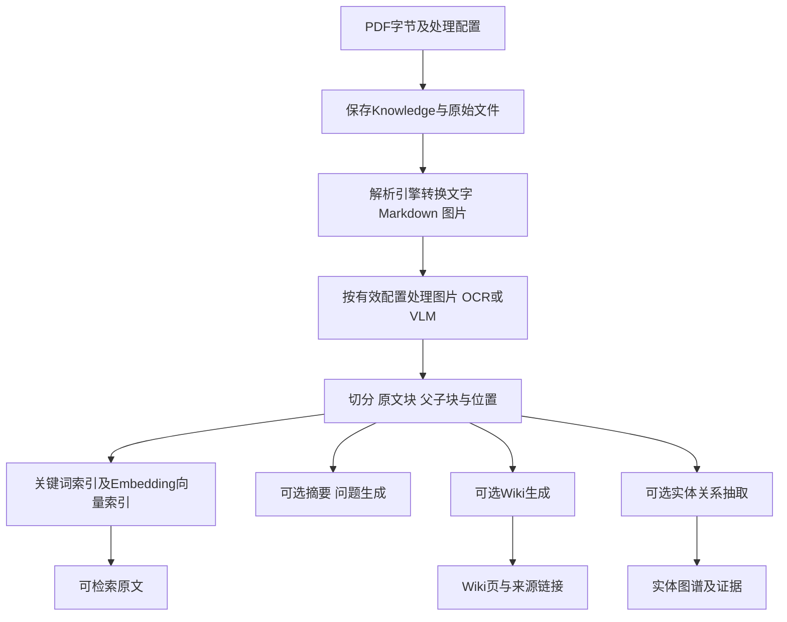
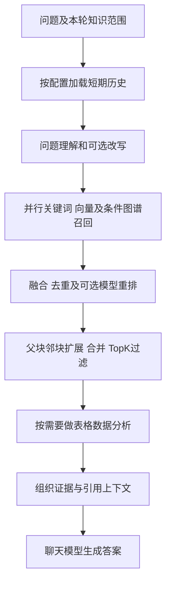
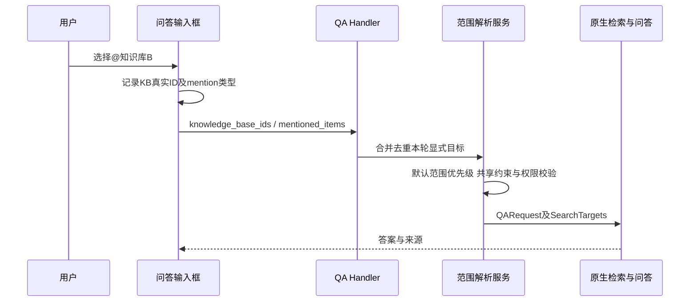

# WeKnora 问答机制说明：解析、RAG、Wiki、智能体与 @知识库

日期：2026-10-16。依据本地 `E:\GoLandCode\WeKnora` 的 `bea1d33ee` 源码追踪；文件行号用于当前版本定位，后续应按符号查找。本文说明**目前如何工作**，不是将规划接口描述成已实现，也不把本地fork扩展都归为腾讯官方原生功能。

配套执行方案：[五工具集成与安全裁剪](../superpowers/plans/2026-10-16-mcp-core-integration-and-pruning.md)。

## 1. 先区分这些“模式”

| 概念 | 决定什么 | 示例 |
|---|---|---|
| 上传通道 | 文件字节如何送到服务器 | MCP base64工具、兼容multipart |
| 解析引擎 | PDF怎样变成文字/Markdown/图片与位置线索 | builtin、MinerU、PaddleOCR-VL等实际可用引擎 |
| 分块策略 | 把解析后的内容切成多大、多连贯的片段 | 长度/重叠、标题切分、父子块 |
| 索引能力 | 资料用什么结构保存以便查询 | 向量、关键词、Wiki、实体图谱 |
| 检索模式 | 本次怎样召回候选资料 | semantic、keyword、hybrid |
| 问答模式 | 谁组织检索、如何形成最终答案 | quick-answer固定流水线、smart-reasoning工具推理 |
| 知识库范围 | 这轮选择到哪里查询 | KB A、A+B、指定文档/标签 |

这些是独立维度。上传工具切换不是解析器切换；混合检索不是Wiki融合；智能推理也不自动等于已启用Wiki/图谱。

## 2. 一份PDF如何变成可以回答问题的资料



原始文件、Knowledge记录、Chunk、索引和Wiki页是不同对象。文件上传成功，只说明服务器收到资料；解析成功说明产生了内容；索引成功才有相应检索能力；Wiki与图谱可能继续异步处理，也可能没有启用。

源码入口：`internal/handler/knowledge.go` 的CreateKnowledgeFromFile；`internal/application/service/knowledge_process.go` 的转换、分块与索引；`knowledge_post_process.go` 的Wiki/graph后处理。

### 2.1 解析器是怎么选出来的

持久知识库文档的优先级：

1. 本次上传的单文档process_config覆盖。
2. 知识库设置的ParserEngineRules。
3. 文件类型默认选择。

知识库提供基础配置，本次覆盖保存到该Knowledge的metadata，并不会复制出一个新知识库。非空的顶层ParserEngineRules会替换有效规则列表，不是永久向知识库追加一条。workspace引擎参数与单文档同名覆盖参数合并时，单文档优先。

依据：`internal/types/knowledge.go` 的ProcessOverrides/SetProcessOverrides；`knowledge_process_config.go:40/64/335`；`internal/types/knowledgebase.go:339` 的ResolveParserEngine；`knowledge_process.go:4181/4212/4221` 的解析配置合并与实际引擎记录。

**临时聊天附件是另一条路径**：显式parser_engine → Agent的ChatParserEngineRules → workspace兼容规则/默认。临时附件不代表已经进入持久知识库。见 `internal/handler/session/temporary_document.go:53/76` 与 `service/temporary_document.go:423`。

### 2.2 各解析方式是什么意思

可用目录由本地引擎注册与远端DocReader发现合并，带available和不可用原因。界面应按运行目录显示，不能因为源码支持就声称当前部署能运行。

| 方式 | 含义 | 要检查什么 |
|---|---|---|
| 使用知识库默认 | 本次不覆盖，让知识库规则和文件类型默认决定 | 实际applied引擎，不能显示“默认”就认为没运行 |
| builtin | DocReader内置解析套件；当前PDF默认走此路线 | DocReader连接、每页文字/扫描分类、后续图片处理配置 |
| simple | Go内置的基础格式处理 | 支持格式列表；不能当成通用PDF解析器 |
| anydoc | 进程内Office等格式转换 | 构建是否链接、该格式是否支持；当前PDF默认不选它 |
| mineru / mineru_cloud | 自托管或云端文档解析 | 部署、凭证及支持格式，由WeKnora控制面配置 |
| paddleocr_vl / paddleocr_vl_cloud | 自托管或云端视觉文档解析 | 实际服务可用性和凭证 |
| weknoracloud / 其他远端项 | 托管或DocReader动态提供的引擎 | 以发现目录为准，不硬编码一份万能列表 |

见 `internal/infrastructure/docparser/{engines,engine_registry}.go`，尤其ListAllEngines和preferAnydocWhenAvailable：后者明确排除了PDF。

### 2.3 文字PDF、扫描PDF、OCR和VLM

- 文字PDF有可提取文字层，解析器可直接提取文字及部分版面。
- 扫描PDF往往只有图片，需要OCR或视觉模型才可能取得其中的文字/表格。
- OCR主要做图像文字识别；VLM还可解释图表和页面布局，但输出仍需来源核验。
- 混合PDF可能一页有文字、一页是扫描图；不能对整份文件只看一个“扫描/非扫描”标签。

当前builtin PDF逐页分类，文字页提取内容，扫描页渲染图片。DocReader facade主要输出Markdown/图片；内置路线的后续OCR/VLM由Go侧有效多模态/图片策略决定。集成的外部视觉解析引擎也可能在其服务内完成识别，不能把所有解析器都描述为同一处理过程。

`pdf_force_scanned`意味着强制渲染为图片，**不等于已经配置了OCR，也不保证能识别成功**。实际还要有可用的多模态模型/图片动作。见 `docreader/parser/pdf_parser.py:133/175`、`docreader/parser/parser.py:33`。

### 2.4 目前MCP真正开放的配置

本地已有 `list_parser_engines` 与import的process_config。但是 `parseImportProcessConfig` 当前只允许：

```json
{"parser_engine_rules":[{"file_types":["pdf"],"engine":"builtin"}]}
```

引擎名须在当前目录可用并支持该格式；未知配置字段会拒绝。内部KnowledgeProcessOverrides虽还有chunking、OCR/多模态、graph、图片策略等，**这些不等于主产品现在都能经MCP设置**。相关代码为 `internal/mcpserver/tools_engines.go` 和 `tools_import.go:96-169`。

以后要加“自动/强制OCR”，应增加经过验证的业务枚举并检查模型是否可用，不能直接让主产品传服务URL或云密钥。

### 2.5 分块、Embedding与关键词索引

分块控制检索颗粒度：太小容易丢上下文，太大容易混入无关内容。重叠保留边界信息；标题切分尽量保留章节；父子块用小块召回后补充较大父块。

Embedding把文本映射到向量，用相似性寻找语义相关内容；关键词检索更适合编号、名称、精确术语。chunk_size、overlap、strategy、token_limit属于切分参数，不是OCR引擎。向量模型也不是最终生成答案的聊天模型。

索引开关独立；KB存在或图谱/Wiki开启，不代表一定启用了向量/关键词。见 `internal/types/knowledgebase.go` 的ChunkingConfig、KBCapabilities，以及 `knowledge_process.go` 的BatchIndex。

## 3. quick-answer内部的RAG算法

RAG可以概括为：**先找证据，再把证据放进上下文，最后让模型据此回答。** WeKnora的快问不是只做一次向量查询。

当前有知识目标时的主链：



当前全功能源码还编排MEMORY_RECALL；WEB_FETCH仅在联网开关满足时加入。裁剪方案要求去掉这些非核心分支，**但保留LOAD_HISTORY与基础会话消息**。无知识目标且无联网时可能走纯聊天，因此“模型能回答”不能证明检索生效。

入口 `service/session_knowledge_qa.go:25/211`；各阶段在 `service/chat_pipeline/`。改写开关关闭且无图片时，问题理解可以直接跳过模型调用（query_understand.go:66），不应把每个阶段都解释成固定一次LLM请求。

### 3.1 关键词与向量怎样融合

当前HybridSearch按可用检索store扇出候选，然后使用**加权RRF**，不是把BM25原始分数和cosine相似度直接相加。

```text
raw = w_vector / (k + vector_rank)
    + w_keyword / (k + keyword_rank)

score = raw / ((w_vector + w_keyword) / (k + 1))
```

默认 `k=60`、向量权重0.7、关键词权重0.3，可配置。只命中一路只计算那一路；同一chunk在同类结果列表取最好名次。排名靠前并在两路都出现的内容更占优势。

若只有向量一路，保留相似度；只有关键词一路，按对应列表最大分缩放非有界分数再排序。关键词的具体实现取决于绑定的存储，不应把所有后端都说成同一套数据库BM25。

见 `knowledgebase_search.go:129/197`、`knowledgebase_search_fusion.go:59/170` 与 `internal/types/retrieval_config.go:93/102`。这些分数是排序信号，**不是答案正确率或置信概率**。

### 3.2 为什么还要Rerank和MMR

召回追求先拿到可能相关内容；重排再比较问题与片段的相关程度。当前共享重排可限制候选、调用模型打分、过滤阈值、合并信号，再用MMR减少重复。

当前综合分：

```text
score = clamp(0.6 * rerank_model_score
            + 0.3 * retrieval_score
            + 0.1 * source_weight, 0, 1)
```

MMR默认相关性权重lambda为0.7，在相关性与多样性之间取舍，不是又做一遍向量索引。图谱结果没有检索相似度时有专门base处理。

没有配置重排模型或模型不可用时会降级保留召回序，不能据“流水线有rerank”宣称该轮确实跑过重排。见 `chat_pipeline/rerank.go:73-88`、`internal/reranking/rerank.go:360`、`mmr.go:12`。

后续父块/邻块合并、TopK和上下文长度会继续筛选资料；没有自动保证找齐全部相关文档。需要独立的文档召回率、证据阅读率、事实准确性和引用支持率评估。

### 3.3 图谱什么时候参与

图谱实体抽取插件也挂在QUERY_UNDERSTAND阶段。满足Neo4j配置、问题需要检索、KB有提取能力等条件时，识别实体并查询关系，再与普通候选合并去重；不是每轮必跑。

文档图谱生成也需要实体/关系类型、模型及已完成的任务。`graph enabled=true`只表示打开开关；`graph_ready`才表达配置前提是否足够。没有数据的图不是检索成功证据。

见 `chat_pipeline/extract_entity.go:58`、`search_parallel.go:143/170`；知识库新建相关MCP代码已区分graph开关与ready。

## 4. Wiki与RAG到底怎样融合

### 4.1 两者保存的内容不同

| 资料层 | 擅长回答 | 风险及核验 |
|---|---|---|
| 原文RAG | 具体数值、原句、编号、细节 | 分块漏召回或上下文不足，需要回读 |
| Wiki | 跨文档概览、术语、主题关系与导航 | 模型归纳可能失真或过期，需追溯source_refs |
| 实体图谱 | 谁负责谁、依赖/属于等关系 | 抽取不是事实本身，需关系来源证据 |

Wiki通常在入库后异步归纳/更新主题与概念页面，带页面链接和原资料来源。它不是另一个聊天模型，也不是把每个PDF简单换名。Wiki页面图描述页面间关系，不等于Neo4j实体关系图。

### 4.2 当前可靠路径：知识Agent按需编排

已有 `config/agent_type_presets.yaml` 的 `hybrid-rag-wiki` 预设，为Agent提供Wiki搜索/读页、原文搜索/读文档等工具。系统提示指导它：先用Wiki建立背景或定位主题，再按问题需要核验原文中的具体证据；也可先查原文再补Wiki。

例如“介绍青岚计划，并说明哪些批次可以放行”：

1. 查Wiki概览，确定项目、相关资料与术语。
2. 回读原PDF的有效版本规则和批次表。
3. 根据原文计算并给结论。
4. 分别引用概览与数值来源；若Wiki与原文冲突，比较版本和适用范围，不能仅因为Wiki是摘要就优先相信它。

这属于**工具编排层的证据融合**，不等于向量分数融合；模型也不应为了形式强制每题都调用两套工具。见 `config/agent_type_presets.yaml:105` 与 `config/prompt_templates/agent_system_prompt.yaml:153`。

### 4.3 不应夸大现有WikiBoost

本地有PluginWikiBoost：只有RerankResult已经含 `ChunkTypeWikiPage` 且检索目标有Wiki库，才把该类分数乘1.3并重排。

但本轮源码检查发现：`wiki_page.go:78` 的CreatePage主要写wiki_pages与页面链接；没有找到生产路径为新Wiki页面创建并索引对应wiki_page chunks。现有常量、boost及旧chunk清理逻辑，不能证明Wiki内容已自动进入快问向量索引。

因此目前不能说：“知识库开了Wiki，quick-answer就必然同时检索Wiki并与原文自动融合。”若要提供这种固定流水线融合，需要新增/核验Wiki索引同步和更新/删除一致性，或明确做服务端双路检索融合。这是额外实现，不是改一个开关即可。

证据：`chat_pipeline/wiki_boost.go:15/53-85`、`internal/container/container.go:508`、`service/wiki_page.go:78`。这是本地源码范围内的结论，不排除外部数据写入或未来版本采用不同方案。

## 5. smart-reasoning与外部LangChain的区别

WeKnora内部的smart-reasoning使用Go ReAct引擎：

```text
问题+有效范围 → 模型选择知识工具 → 执行工具 → 工具结果回到上下文
             → 继续检索/回读，或结束生成答案
```

受工具白名单、max_iterations、上下文预算等约束。工具不是越多越好；知识型Agent应只挂载所需的搜索、阅读、Wiki、图谱，不需要shell、网络搜索或长期记忆。

外部 `WeKnora-Agent/agent.py` 的LangChain create_agent是另一套客户端运行时。主产品调用MCP ask运行的是WeKnora内部引擎，不会先调用外部LangChain再绕回来。

目前MCP显式 `mode=smart-reasoning` 映射内置smart Agent，**不自动选择hybrid-rag-wiki预设**。不传mode时采用端点DefaultAgentID，未配才是内置快问。主产品要选RAG/Wiki融合profile，需受控发布映射；不能接受任意内部Agent ID。

见 `internal/agent/engine.go:307/694`、`service/session_agent_qa.go:398`、`service/agent_service.go:1004/1054/1072`、`internal/mcpserver/tools_ask.go:139`。

## 6. 创建智能体与知识库的机制

### 6.1 创建的是配置，不是另建知识库或训练模型

智能体记录保存：模型、系统提示、运行模式、工具白名单、检索参数、默认KB范围、是否只有被@时才检索等。

前端AgentEditorModal形成config payload，通过createAgent/updateAgent提交；后端校验租户与配置，存入custom_agents的JSON配置。KB关联主要是配置里的ID列表，而不是给智能体复制一份PDF。

一个Agent可用多个KB，一个KB可被多个Agent使用；各Agent能采用不同模型、提示词和工具。资料更新由KB与其索引/Wiki任务管理，关联Agent随后检索更新后的资料，不需逐Agent重新上传。

源码：AgentEditorModal中的kb_selection_mode/knowledge_bases保存；`internal/types/custom_agent.go:87/198-205/493`；`service/custom_agent.go:73`；`repository/custom_agent.go:26/54`。

### 6.2 默认知识范围的三个选项

| 配置 | 意义 |
|---|---|
| all | 动态从当前可读、符合能力的KB选择默认检索目标，不是系统中所有人的库 |
| selected | 使用配置保存的KB IDs作为默认范围 |
| none | 不隐式绑定知识库；仍应按当前产品规则处理用户显式选库 |

`retrieve_kb_only_when_mentioned` 控制没有显式目标时是否使用默认库；不是授权开关。

同租户普通Agent的默认KB不一定是永久不可越过的安全白名单。共享Agent有额外范围限制，读权限还由实际服务层校验。见 `session_knowledge_qa.go:358` 的resolveKnowledgeBasesFromAgent与 `session_qa_helpers.go`。

### 6.3 创建KB时又配置了什么

KB保存文档、chunk、索引与能力配置；embedding模型、解析规则、Wiki/图谱开关和类型等属于资料处理层。聊天/摘要模型、VLM、rerank有不同职责，不能只配一个“模型”就假设全部能力可用。

当前本地MCP建库已继承workspace默认模型，并区分graph开关和类型准备；单靠enable_graph=true不能产生有效实体关系。修改解析器或后处理设置也不代表存量文档已重跑，需要正式重解析/重建任务。

## 7. 问答处 @知识库是怎样实现的

### 7.1 不是只在提示词里加“请只查某库”



前端MentionSelector选中知识库/文档/标签，将其变成结构化项。Input-field的send-msg携带ID，不要求LLM从库名里猜数据库对象。

请求形状示意：

```json
{
  "query":"青岚计划负责人是谁？",
  "knowledge_base_ids":["kb-B"],
  "knowledge_ids":[],
  "mentioned_items":[{"id":"kb-B","name":"知识库B","type":"kb"}]
}
```

这是原生问答请求字段示意，不是可直接粘贴的真实ID，也不是新core五工具完整schema；原生流式接口与MCP ask的字段名分别为query/question等。

路径：`frontend/src/components/Input-field.vue:1765/2127/2140/3011` → `frontend/src/views/chat/index.vue:1504/1535` → `frontend/src/api/chat/streame.ts:96/100/139` → `internal/handler/session/qa.go:247/662` 的mergeKnowledgeTargets → QARequest。

### 7.2 后端选择范围的优先级

`session_qa_helpers.go:36` 的resolveKnowledgeBases大致按以下顺序：

1. 本轮显式KB/文档/标签目标存在：按本轮目标处理。
2. 没有显式目标且设置了“只有@才检索”：不使用默认KB（受控推荐问题来源等已有例外另作处理）。
3. 否则使用Agent的all/selected/none默认范围。

之后再做共享Agent范围交集、API key scope、KB拥有者/共享读权限等校验；HybridSearch还逐库授权。**显式选择能覆盖默认选择，不代表能获得原本没有的读权限。**

共享Agent限制见 `session_qa_helpers.go:361` 的restrictMentionsToAgentScope；API key scope见同文件约76行；SearchTargets权限见 `session_knowledge_qa.go:482-516`；逐库授权见 `knowledgebase_search.go:197`。

### 7.3 为什么“@B就只查B”有条件

当前原生页面会把侧栏选择与mentions合并：

| 用户操作 | 当前选择结果 |
|---|---|
| 侧栏无其他库，只@B | 显式B，按权限检索B |
| 侧栏已选A，再@B | **A∪B**，不是B独占 |
| 只@B中的文档D | 文档级目标D |
| 已整库选B，再@B中的文档D | 整库目标仍在，D不会把整库自动缩窄 |
| @无权限的B | 后端应拒绝或过滤，不因@授予权限 |

整库与文档目标合并见 `session_knowledge_qa.go:477/534` 的fullKBSet相关逻辑。

如果主产品希望“这次选择B就是严格只查B”，应让主产品提交唯一的有效范围，并显示服务器回显；不要直接复制原生页面的合并行为又在文案上声称“只查B”。

### 7.4 会话历史也会带来“像在查其他库”的现象

范围限制作用于当前检索，不自动抹掉先前聊天中的答案。即使本次只检索B，历史里仍可能有上轮A的内容。

因此验证范围时要用新会话，或提供明确的无历史单轮模式；范围/mode/profile变化时，主产品应清会话或执行服务端绑定检查。在检查真正的权限泄漏前，应分别看“本轮工具返回资料”和“已存在的历史内容”。

基础LOAD_HISTORY与长期记忆不同：前者服务当前会话多轮，后者是跨会话召回/抽取。裁剪长期记忆不要求删除前者或messages表。

## 8. MCP与原生页面如何对齐

原生页面的mention最终变成ID级范围；主产品不必实现WeKnora的同一套输入框，直接将选择结果传给MCP ask即可：

```json
{"question":"青岚计划负责人是谁？","knowledge_base_ids":["kb-B"],"mode":"quick-answer"}
```

本地fork还要求外部身份与工作空间头，并支持KB header收窄。主产品应保持参数/header同一范围；最终权限仍由服务端执行。请求scope与Agent默认scope、共享Agent限制不应混为一个字段。

腾讯官方Go端点与本地fork的认证/模式/上传能力存在差异：官方依端点Bearer和配置运行，本地新增用户身份及mode/process_config扩展。比较见配套方案，不能将主产品设计说成通用MCP协议本身要求这些业务字段。

## 9. 演示与评估时如何证明生效

1. 上传随机标记的PDF，只放库A；核验真实新文档与实际解析器，不能仅看上传回执。
2. 在A问随机标记、表格计算和有效版本规则，要求回读原文和可定位引用。
3. 换到未上传该文件的B，用新会话同问；应资料不足，而不是编造或沿用A的答案。
4. 扫描页问题检查OCR/图像来源；纯文字模式不能答出时说明能力边界。
5. 对Wiki融合profile，记录实际wiki_search/wiki_read与原文回读证据；不是“开关打开”就算融合生效。
6. 对graph问题，检查实体关系及每条source_ref可回读；空关系或未配置不算成功命中。
7. 原始资料、Wiki归纳与图谱推断分开标注；准确性、完整性、完成率分别计。

已有测试资料：`E:\GoLandCode\WeKnora\output\pdf\WeKnora-PDF验收样本-青岚计划.pdf`，标准答案在同目录的独立Markdown，后者不要上传索引。单样本验证上述路径，不证明全库全量召回。

## 10. 关键源码索引

| 主题 | 路径/符号 |
|---|---|
| 内部处理覆盖字段 | internal/types/knowledge_process.go: KnowledgeProcessOverrides |
| 解析默认与能力 | internal/types/knowledgebase.go: ResolveParserEngine/KBCapabilities |
| 引擎发现与路由 | internal/infrastructure/docparser/engine_registry.go: ListAllEngines/NewReader |
| 文档处理/索引 | service/knowledge_process.go、knowledge_process_config.go、knowledge_post_process.go |
| 快问主链 | service/session_knowledge_qa.go: KnowledgeQA |
| 候选融合 | service/knowledgebase_search_fusion.go: fuseWithRRF |
| 重排 | internal/reranking/rerank.go、mmr.go |
| Wiki权重与页写入 | service/chat_pipeline/wiki_boost.go、service/wiki_page.go |
| 知识混合预设 | config/agent_type_presets.yaml: hybrid-rag-wiki |
| 原生ReAct | internal/agent/engine.go: Execute/runReActIteration |
| 本轮范围解析 | service/session_qa_helpers.go: resolveKnowledgeBases |
| @合并 | frontend/src/views/chat/index.vue；handler/session/qa.go: mergeKnowledgeTargets |
| MCP问答/解析覆盖 | internal/mcpserver/tools_ask.go、tools_import.go、tools_engines.go |

表中service路径指 `internal/application/service/`，handler路径指 `internal/handler/`。本文基于静态源码追踪，配置相关和外部模型可用性还需实际环境验证；不把实现里存在一个分支当成每轮都运行。
